

<h1 align="center">无界手语 SignFlow AI</h1>

<h3 align="center">AI + 无障碍公共服务平台</h3>

<strong>让手语沟通自然进入每一次服务</strong>

  <code>图片识别</code>　<code>视频识别</code>　<code>实时摄像头</code>　<code>CSL / ASL</code>　<code>结果追溯</code>　<code>网页 / H5 / 微信小程序</code>

  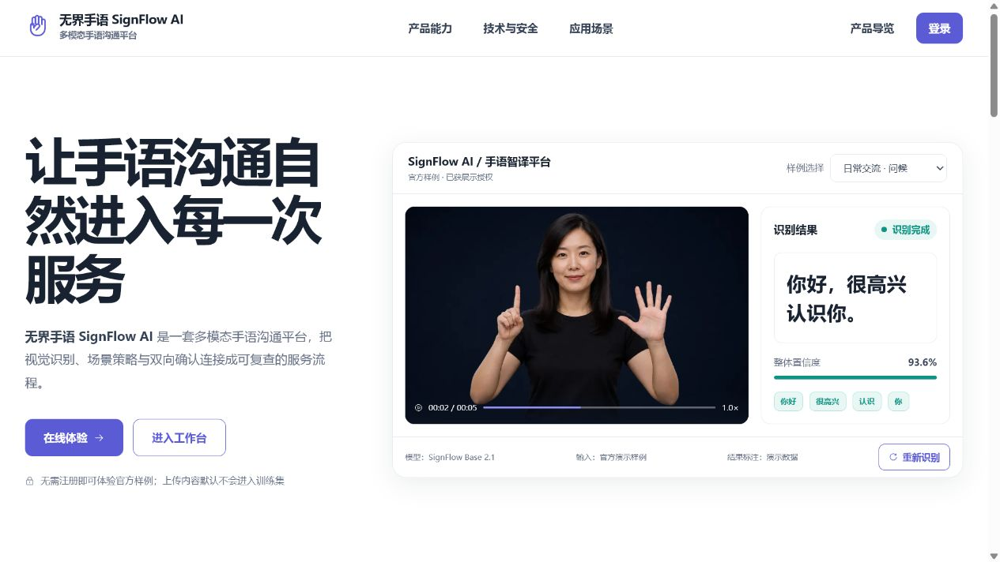

产品首页 · 商业化品牌入口与完整服务闭环

---

| 报告信息 | 内容 |
|---|---|
| **参赛方向** | 赛题三——面向科学、工程和社会科学的“AI+X”应用 |
| **交叉领域** | 人工智能 × 无障碍公共服务 × 社会包容 |
| **报告版本** | Submission 3.1 · 图文完整系统介绍版 |
| **验收日期** | 2026-07-30 |

> **报告口径**  
> 本报告基于当前可运行系统、现有本地模型权重、真实浏览器操作和自动化测试编写。本次没有训练、微调或改写任何 `.pt` 权重文件；样例展示、单次任务置信度与模型总体评测采用三套独立口径。

## 阅读导航

| [01 项目价值](#section-1) | [02 产品闭环](#section-3) | [03 全部界面](#section-4) | [04 技术架构](#section-5) |
|---|---|---|---|
| [05 模型评测](#section-6) | [06 真实识别](#section-7) | [07 安全追溯](#section-8) | [08 工程验收](#section-10) |

### 一页看懂产品

| `3` 种输入 | `2` 套模型 | `3` 类场景 | `24` 个界面 |
|:---:|:---:|:---:|:---:|
| 图片 · 视频 · 摄像头 | 中国手语 CSL · 美国手语 ASL | 政务 · 医疗 · 特殊教育 | 公共页 · Web · 管理端 · 手机端 |

<table>
  <tr>
    <td width="50%">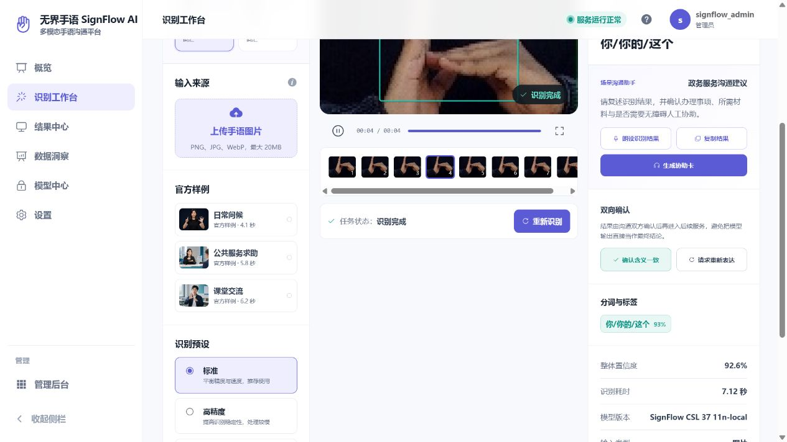</td>
    <td width="50%">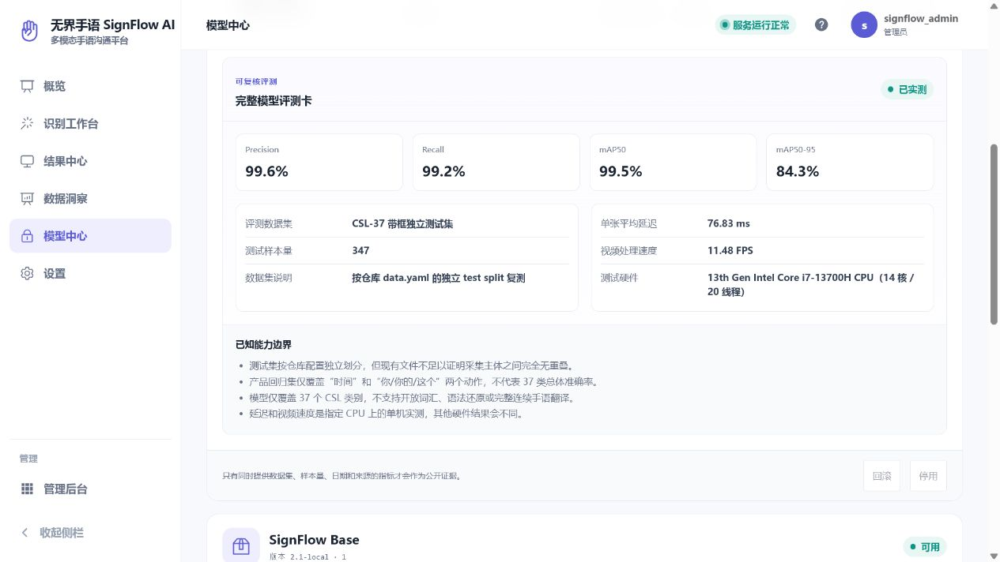</td>
  </tr>
  <tr>
    <td align="center">真实推理：识别、建议、朗读与双方确认</td>
    <td align="center">可信评测：指标、数据集、硬件与能力边界</td>
  </tr>
</table>

---

## 1. 项目定位与赛题匹配

无界手语 SignFlow AI 是一套面向公共服务沟通的多模态手语识别平台。项目将计算机视觉识别能力嵌入政务服务、医疗导诊和特殊教育等真实工作流，把单一的“标签识别”扩展为可上传、可推理、可朗读、可复制、可确认、可追溯的沟通闭环。

项目最适合赛题三。它以人工智能为核心技术，把视觉感知、软件工程、无障碍交互、数据治理与公共服务流程进行交叉融合，直接面向真实社会问题形成可运行产品。平台运行界面保持商业产品的中性表达，赛题映射只出现在申报材料中，不影响后续上线和行业推广。

### 核心价值

- **对手语使用者：** 降低窗口、导诊和课堂沟通中的信息障碍，提供大字、高对比、朗读和协助卡等后续动作。
- **对服务人员：** 将识别结果与服务场景建议、双方确认和历史追溯放在同一工作台，降低误解风险。
- **对机构：** 提供模型评测卡、任务记录、版本对比、数据保留策略和多端交付能力，便于审计与持续改进。

### 当前可验证成果

| 维度 | 已实现能力 |
|---|---|
| 多模态输入 | 图片、视频、实时摄像头 |
| 双模型切换 | 中国手语 CSL 37 类、美国手语 ASL 80 类 |
| 场景策略 | 政务服务、医疗导诊、特殊教育 |
| 沟通闭环 | 识别、场景建议、朗读、复制、协助卡、双方确认 |
| 结果治理 | 原始媒体、SHA-256、模型版本、识别参数、版本对比 |
| 多端交付 | 响应式网页、H5、微信小程序构建产物 |

## 2. 真实问题与需求分析

公共服务中的手语沟通不是单纯的分类问题。即使模型识别出了一个动作，服务双方仍然需要理解结果、确认含义、继续办理并在必要时追溯。传统演示型系统常见的断点包括：只能展示单张图片、结果不能朗读或复制、模型指标没有数据集说明、任务失败后无法追踪、前端和手机端只是静态样例。

本项目将需求拆解为四层：

1. **感知层需求：** 同时接收图片、视频和摄像头输入，并允许在 CSL 与 ASL 模型之间明确切换。
2. **沟通层需求：** 识别结果必须能转为服务人员可直接使用的文字、朗读内容和协助卡。
3. **责任层需求：** 关键结果由沟通双方确认，医疗等高风险场景不把模型输出当作最终结论。
4. **工程层需求：** 所有链路具备真实 API、持久化记录、模型评测、安全配置和自动化回归测试。

> 产品目标不是替代手语翻译员或专业人员，而是在常见固定词汇和服务流程中提供及时、可复核的沟通辅助。

## 3. 产品方案与使用闭环

产品围绕“一次真实沟通”设计。用户首先选择政务、医疗或教育场景，再选择图片、视频或摄像头输入以及 CSL/ASL 模型。推理完成后，平台展示标签、整体置信度、耗时和模型版本，并生成场景化沟通建议。服务双方可以朗读、复制、生成本机协助卡、确认含义一致或请求重新表达。

完整流程为：

### 商业化界面策略

- 公共首页以无障碍服务价值为主，不展示开发日志、训练过程或比赛口号。
- 产品导览用场景、流程和可信机制解释能力，所有导航使用真实路由。
- 登录后的概览、工作台、结果中心、数据洞察、模型中心和设置形成完整信息架构。
- 隐私与数据保留页面公开说明上传数据用途、保留期限、导出与删除方式。

## 4. 系统界面全景说明

本节按照真实路由逐页说明当前系统，不只展示“最好看的一张页面”。界面覆盖公共访问、登录后的 Web 产品、管理后台以及 uni-app 手机端四个区域，共 24 个可访问页面；识别工作台中的图片、视频和摄像头模式作为同一业务页面的三种输入状态单独说明。每个页面都明确入口、目标用户、信息结构、关键操作、后台数据关系和现场展示重点。

### 4.1 页面与路由总览

| 区域 | 页面 | 路由 / 入口 |
|---|---|---|
| 公共访问 | 产品首页 | `/` |
| 公共访问 | 产品导览 | `/product-tour` |
| 公共访问 | 公开样例结果 | `/product-tour/results/:id` |
| 公共访问 | 登录 | `/auth/login` |
| 公共访问 | 注册 | `/auth/register` |
| 公共访问 | 隐私与数据保留 | `/privacy` |
| 公共访问 | 页面未找到 | 任意无效路由 |
| Web 产品 | 运行概览 | `/app/overview` |
| Web 产品 | 识别工作台 | `/app/workbench` |
| Web 产品 | 结果中心 | `/app/results` |
| Web 产品 | 结果详情 | `/app/results/:id` |
| Web 产品 | 数据洞察 | `/app/analytics` |
| Web 产品 | 模型中心 | `/app/models` |
| Web 产品 | 账户与设置 | `/app/settings` |
| 管理后台 | 用户管理 | `/admin/users` |
| 管理后台 | 角色权限 | `/admin/roles` |
| 管理后台 | 系统运行 | `/admin/system` |
| 手机端 | 登录 | `pages/login/login` |
| 手机端 | 注册 | `pages/register/register` |
| 手机端 | 首页 | `pages/home/home` |
| 手机端 | 识别工作台 | `pages/workbench/workbench` |
| 手机端 | 结果中心 | `pages/results/results` |
| 手机端 | 结果详情 | `pages/result-detail/result-detail` |
| 手机端 | 我的 | `pages/profile/profile` |

### 4.1.1 界面图谱

<table>
  <tr>
    <td width="33%"></td>
    <td width="33%">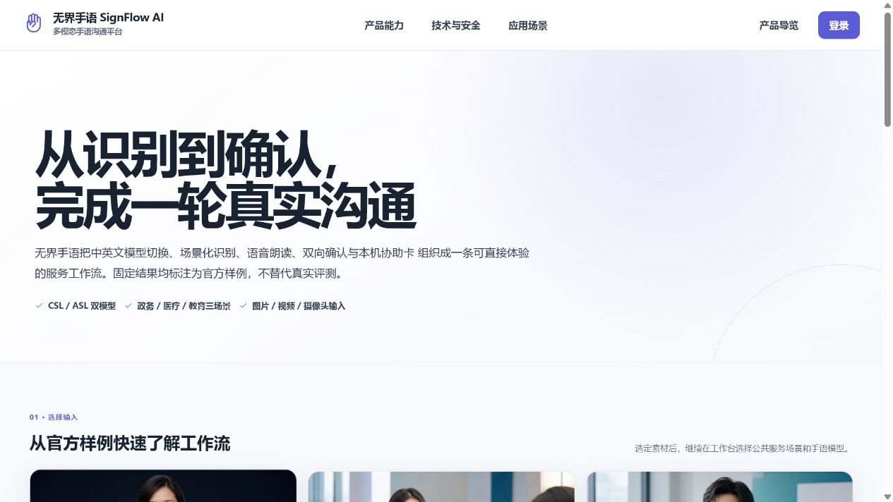</td>
    <td width="33%">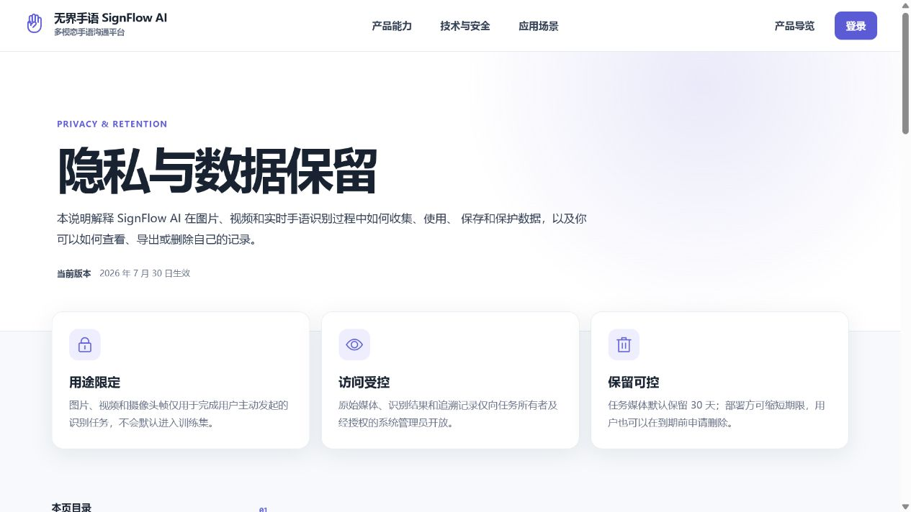</td>
  </tr>
  <tr>
    <td align="center">公共首页</td>
    <td align="center">产品导览</td>
    <td align="center">隐私与数据保留</td>
  </tr>
  <tr>
    <td>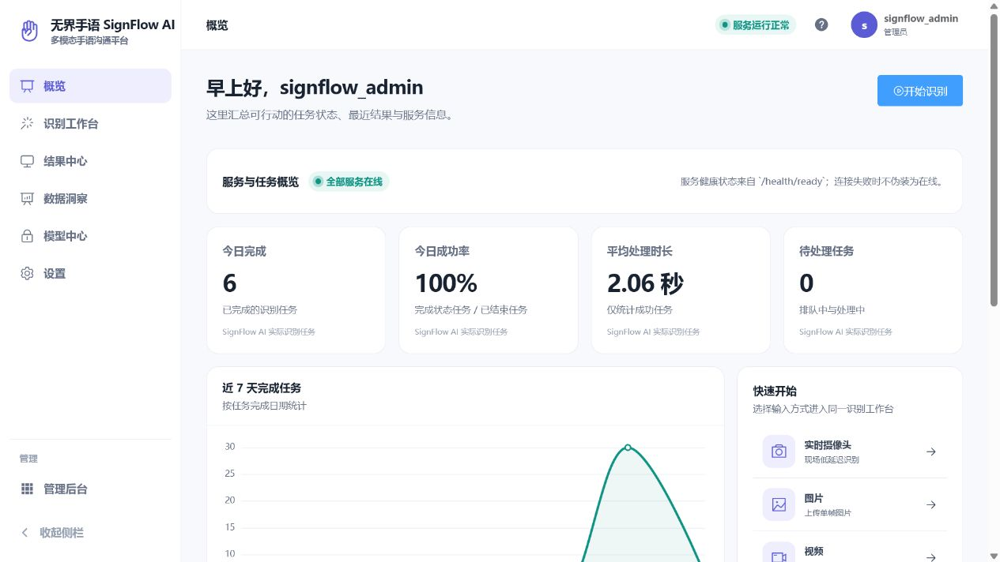</td>
    <td></td>
    <td>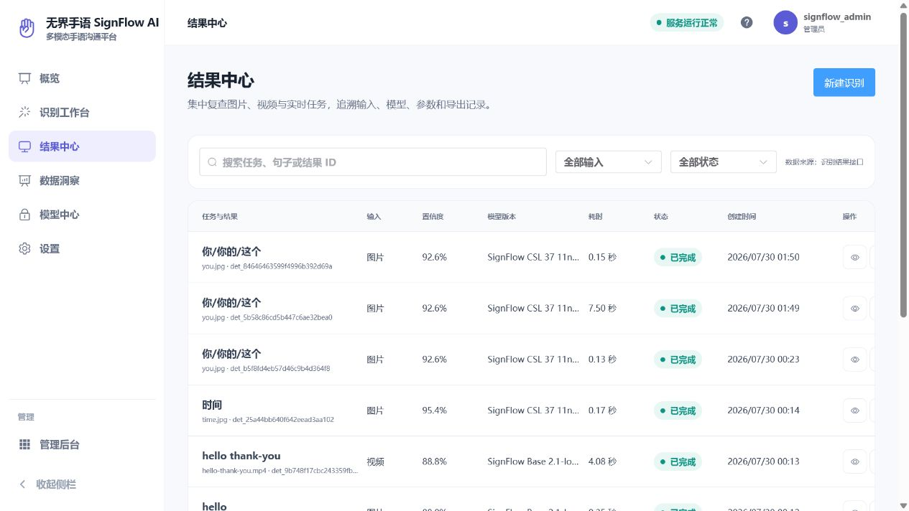</td>
  </tr>
  <tr>
    <td align="center">运行概览</td>
    <td align="center">真实识别</td>
    <td align="center">结果中心</td>
  </tr>
  <tr>
    <td>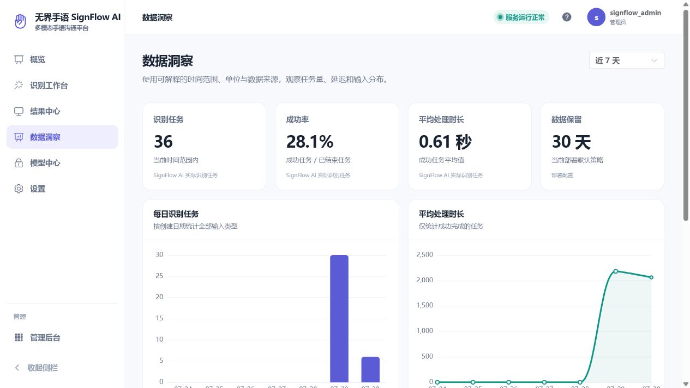</td>
    <td>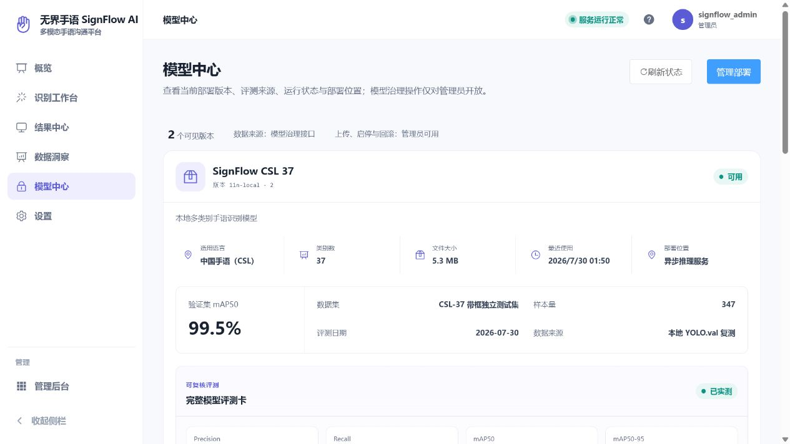</td>
    <td>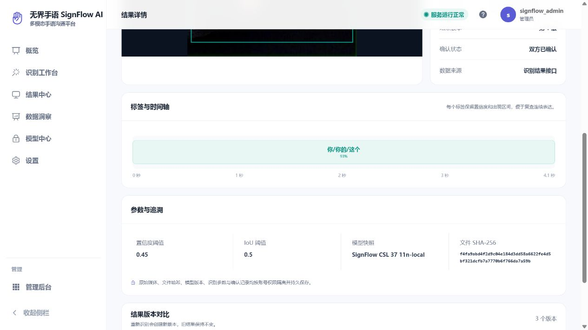</td>
  </tr>
  <tr>
    <td align="center">数据洞察</td>
    <td align="center">模型中心</td>
    <td align="center">证据追溯</td>
  </tr>
</table>

### 4.2 公共访问界面

#### 4.2.1 产品首页

图 4-1　产品首页：从无障碍服务价值进入产品能力与真实体验

**入口与对象：** 首页无需登录，面向手语使用者、服务机构、评委和首次了解产品的访客，是整套系统的品牌与能力总入口。

**信息结构：** 顶部导航连接产品能力、技术与安全、应用场景、产品导览和登录；首屏用“让手语沟通自然进入每一次服务”说明价值；后续依次展示识别预览、三类输入能力、可信机制、公共服务场景、技术与隐私说明以及真实页脚导航。

**核心交互：** 用户可以直接进入产品导览，也可以登录后开始真实识别。页面内锚点使用 `/#capabilities`、`/#security` 和 `/#scenarios`，页脚的隐私政策、服务状态和登录入口均为真实路由。

**数据与可信设计：** 首页只展示产品能力和明确标注的官方样例，不把样例置信度包装为总体模型指标；模型实测数据统一进入模型中心和本报告的评测章节。

**现场展示重点：** 用首页完成一句话定位，并让评委看到项目已经从算法演示升级为具有品牌、场景、可信说明和转化路径的完整产品。

#### 4.2.2 产品导览

图 4-2　产品导览：官方样例、场景选择、双模型切换与沟通闭环

**入口与对象：** 产品导览无需账号，适合评委、机构决策者或普通访客在不上传个人素材的情况下体验完整业务流程。

**信息结构：** 页面先提供“日常问候、公共服务求助、课堂交流”三组官方样例，再进入与正式工作台一致的场景选择、CSL/ASL 模型切换、输入预设、媒体预览、识别结果和沟通行动。

**核心交互：** 用户可切换图片、视频、实时摄像头模式，选择政务服务、医疗导诊或特殊教育场景，调节标准、高精度和低延迟预设，并在完成后查看完整结果。

**样例边界：** 页面持续显示“演示模式”，官方样例使用 AI 生成授权素材，不含真实人物身份数据，不进入训练集，也不作为实时模型准确率证明。

**现场展示重点：** 这一页适合作为无网络上传或摄像头权限受限时的保底演示，同时仍然能够展示识别、沟通和追溯闭环。

#### 4.2.3 公开样例结果

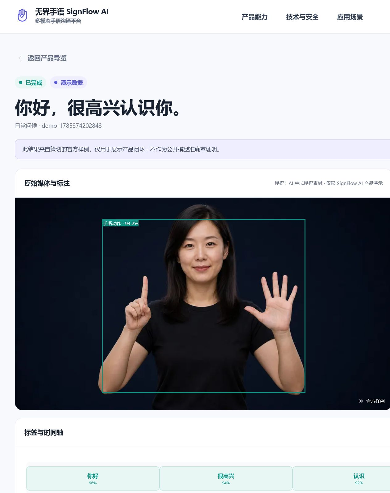

图 4-3　公开样例结果：演示数据、授权媒体与标签口径明确分离

**入口与对象：** 产品导览完成一次官方样例后进入公开结果页。访客无需账号即可理解“识别结束之后系统还能做什么”。

**信息结构：** 页面显示完成状态、演示数据标记、识别文本、样例名称、授权说明、原始媒体、边界框、标签时间线、模型快照和结果说明。

**核心交互：** 用户可以返回导览继续体验其他输入，也可以查看标签及其置信度。公开结果不开放真实账户的重新识别、双方确认或数据管理能力，避免游客数据与正式任务混合。

**可信设计：** 页面在主结果上方明确声明“策划的官方样例，仅用于展示产品闭环”，让演示数据与真实任务、模型评测保持三套独立口径。

#### 4.2.4 登录

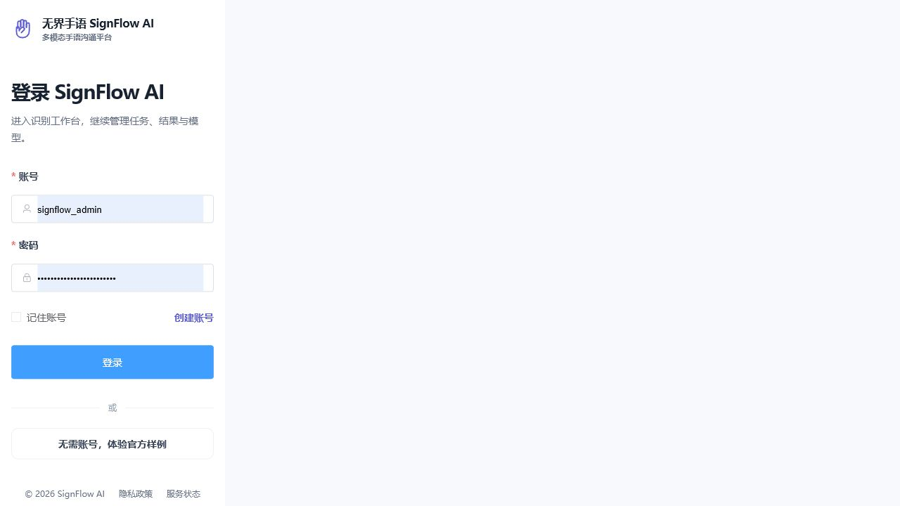

图 4-4　网页端登录：真实账户、隐私入口与恢复路径

**入口与对象：** 登录页服务已注册用户和本地产品管理员，负责进入工作台、结果中心、模型中心及管理后台。

**信息结构：** 左侧说明统一识别工作台、结果追溯和隐私策略，右侧包含账号、密码、记住账号、创建账号、登录按钮、官方样例入口以及隐私和服务状态链接。

**安全交互：** 密码字段使用遮蔽输入，不写入 URL；登录成功后访问令牌保留在页面内存，刷新令牌由 HttpOnly Cookie 承载。前端路由和后端 API 同时验证登录状态。

**异常处理：** 空字段、无效凭据、网络不可用和服务异常均显示可理解的错误信息，登录页仍保留无需账号的产品导览入口，避免用户陷入死路。

#### 4.2.5 注册

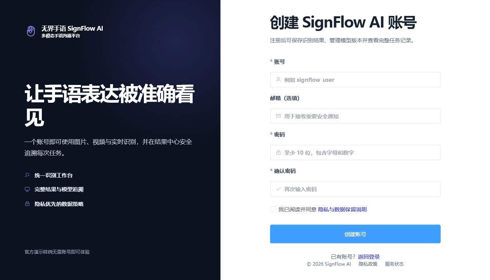

图 4-5　网页端注册：账户、密码校验与隐私同意

**入口与对象：** 注册页面向首次使用者，创建可同时访问网页端和手机端的统一账号。

**信息结构：** 页面提供账号、可选邮箱、密码、确认密码及隐私同意项，并明确注册后可以保存识别结果、管理模型版本和查看完整任务记录。

**校验策略：** 账号限制为 2—100 个字符；密码执行强度和一致性校验；用户必须同意隐私与数据保留说明。后端继续执行唯一性、字段长度和密码安全验证，防止只依赖前端。

**现场展示重点：** 注册页体现产品已经具备真实账户生命周期，而不是依赖写死账号进入静态后台。

#### 4.2.6 隐私与数据保留

图 4-6　隐私与数据保留：将产品承诺变成可直接访问的政策页面

**入口与对象：** 任何访客都可以从首页、登录、注册和页脚进入，适合用户、机构安全人员和项目评审查阅。

**信息结构：** 页面说明数据类别、处理目的、法律与授权基础、默认保留期限、模型训练边界、访问控制、导出与删除、未成年人和高风险场景边界。

**核心承诺：** 上传图片和视频只用于生成当前任务结果，不会默认进入训练集；用户素材、任务和结果按账户隔离；历史媒体不可恢复时明确显示缺失状态，不用样例图替代。

**部署关系：** 默认保留 30 天，可由部署方通过环境配置调整并执行清理。正式部署还需在真实 HTTPS 域名、备份策略和机构制度中落实页面承诺。

#### 4.2.7 页面未找到

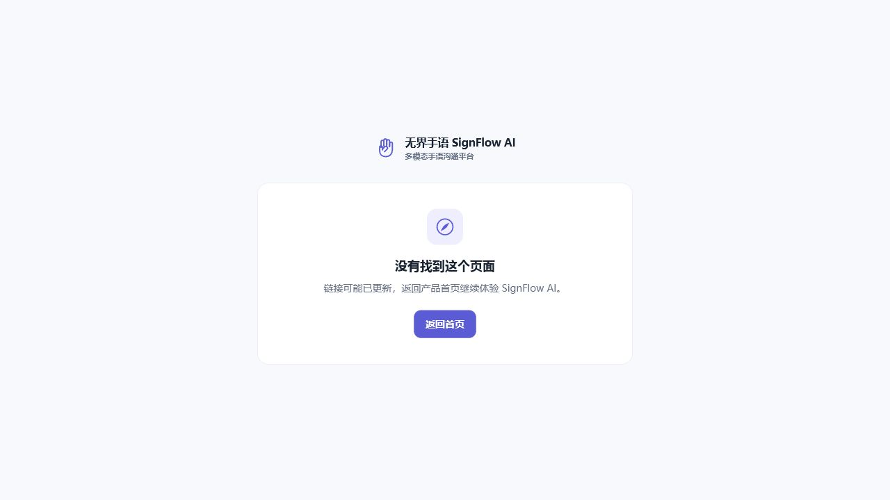

图 4-7　页面未找到：品牌化异常状态与返回首页操作

**入口与对象：** 用户访问已失效收藏、错误链接或未知路由时自动进入。

**信息结构与操作：** 页面保持 SignFlow AI 品牌，清楚提示“没有找到这个页面”，提供返回首页按钮，不显示调试堆栈、框架错误或服务器路径。

**工程价值：** 统一的 404 页面避免空白屏和无效导航，同时配合路由自动化测试防止产品导览、登录、注册和页脚再次出现空锚点。

### 4.3 登录后的 Web 产品界面

#### 4.3.1 运行概览

图 4-8　运行概览：真实统计、趋势图、快捷入口与服务在线状态

**入口与对象：** 登录后的默认首页，面向一线使用者、机构负责人和系统管理员。

**信息结构：** 顶部显示服务在线状态；核心指标包括今日任务、成功率、平均耗时和待确认数；下方呈现任务趋势、最近结果、快捷入口和当前模型状态。

**数据来源：** 页面通过真实统计 API 聚合当前账户任务，不使用前端固定数字。当测试环境包含刻意制造的失败记录时，图表按真实口径显示，不自动美化成功率。

**核心操作：** 用户可以从概览直接新建图片、视频或实时任务，进入待确认记录，打开结果详情，或查看模型与服务状态。

#### 4.3.2 识别工作台

<table>
  <tr>
    <td width="50%">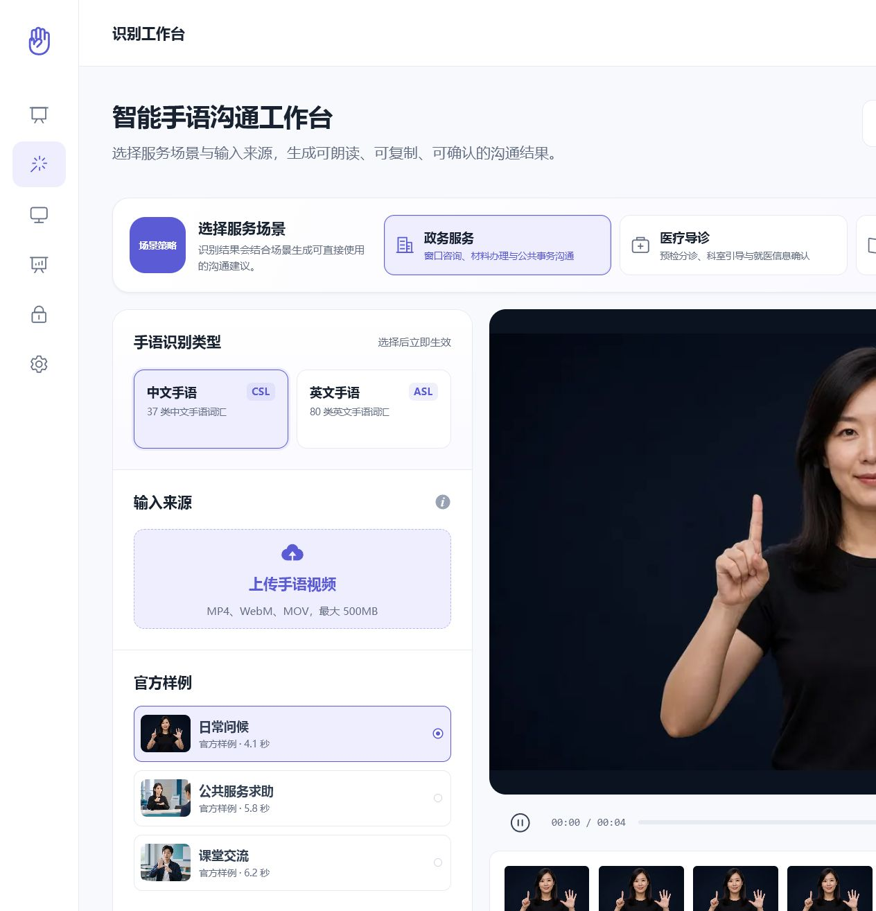</td>
    <td width="50%"></td>
  </tr>
  <tr>
    <td align="center">视频输入、关键帧与模型选择</td>
    <td align="center">真实推理、沟通动作与双方确认</td>
  </tr>
</table>

图 4-9　识别工作台：从输入、推理到沟通行动的完整业务页面

**入口与对象：** 工作台是系统主业务页面，面向正在进行手语沟通的用户和服务人员。

**页面结构：** 顶部选择政务、医疗或特殊教育场景；左侧选择 CSL/ASL、输入来源和识别预设；中央显示媒体、关键帧和识别进度；右侧显示识别文本、置信度、场景建议及沟通动作。

**图片模式：** 支持 PNG、JPG 和 WebP，最大 20MB。上传后生成媒体预览，调用选定模型执行真实推理，并保存任务、文件哈希、模型快照和参数。

**视频模式：** 支持 MP4、WebM 和 MOV，最大 500MB。系统按帧处理并形成标签时间线，界面显示播放进度、关键帧、视频处理速度和可重新识别入口。

**摄像头模式：** 只有用户授权后才访问摄像头；拒绝权限时显示恢复步骤。正式实时链路通过会话票据和 WebSocket 连接，不在未授权状态偷偷开启摄像头。

**模型与场景：** CSL 37 类和 ASL 80 类显式切换并写入任务记录；服务场景只改变沟通建议，不篡改原始模型标签。标准、高精度和低延迟预设映射到可追溯参数。

**结果行动：** 推理完成后可以朗读、复制、生成本机协助卡、确认“双方已理解”、重新识别或进入完整结果详情。高风险内容仍要求人工复核。

#### 4.3.3 结果中心

图 4-10　结果中心：真实任务、状态、模型、置信度与筛选入口

**入口与对象：** 结果中心为用户提供跨图片、视频和实时任务的统一历史记录。

**信息结构：** 页面显示任务总数、完成和失败状态、输入类型、识别文本、模型版本、置信度、创建时间及确认状态；支持按类型、状态、时间和关键字筛选。

**核心操作：** 点击任意任务进入详情；失败任务可以查看原因并重新识别；用户可以定位待确认记录，也可以为后续导出和删除流程选择目标记录。

**数据原则：** 列表来自当前账户的真实任务 API。测试环境中的失败路径会保留，以证明系统能处理错误，不把失败记录从统计中隐藏。

#### 4.3.4 结果详情与证据追溯

<table>
  <tr>
    <td width="50%">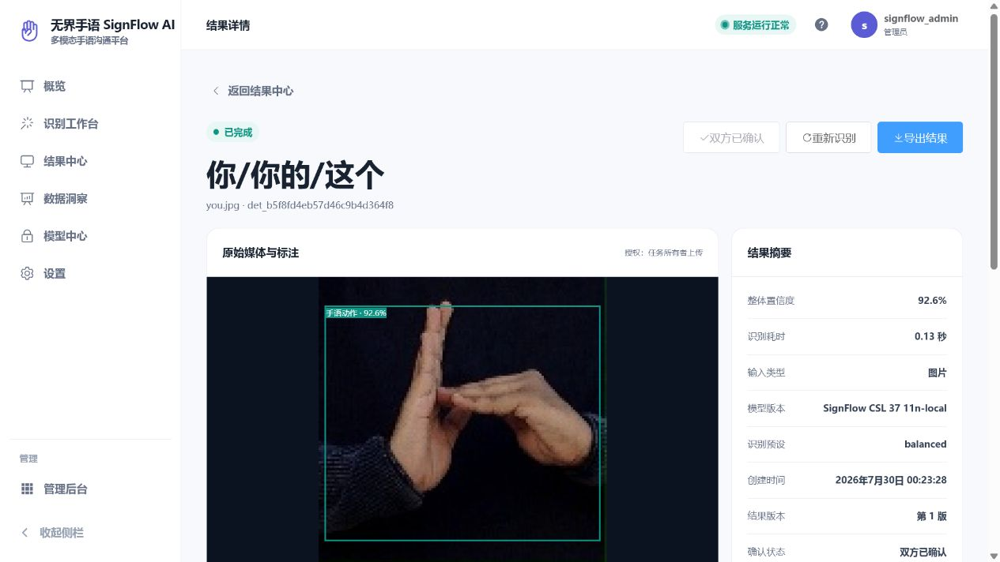</td>
    <td width="50%"></td>
  </tr>
  <tr>
    <td align="center">原始媒体、标签与任务元数据</td>
    <td align="center">SHA-256、模型快照与版本对比</td>
  </tr>
</table>

图 4-11　结果详情：从识别结果升级为可复核的证据链

**入口与对象：** 从结果中心或概览进入，面向任务所有者、服务双方以及需要复核的机构人员。

**结果区域：** 展示授权原始图片或视频、边界框、识别文本、单标签置信度、时间线、模型名称、版本、任务编号、输入类型和创建时间。

**证据区域：** 展示真实 SHA-256、置信度阈值、IoU 阈值、模型快照、数据性质、任务来源、识别耗时、结果版本和确认记录。原文件已经清理时明确写明“不可读取”，不生成伪造哈希。

**闭环操作：** 用户可复制或保存识别文本、朗读结果、重新识别、比较历史版本并持久化“双方已确认”。重新识别会产生新版本，不覆盖旧结果。

**风险控制：** 页面把“模型输出”“用户修订”和“双方确认”分开保存，保证最终沟通结论不会被误认为未经确认的算法原始输出。

#### 4.3.5 数据洞察

图 4-12　数据洞察：统一统计口径与三张 ECharts 图表

**入口与对象：** 面向机构负责人和管理员，用于观察系统使用、任务质量和模型运行趋势。

**信息结构：** 页面显示任务量、成功率、平均耗时、确认情况、输入类型分布、时间趋势和模型使用分布，当前版本使用三张 ECharts 图表。

**交互能力：** 用户可以切换统计窗口、查看图表提示、在响应式布局中阅读并使用导出入口。图表数据来自统计 API，表格与图形采用相同口径。

**指标解释：** 七日成功率包含开发验收阶段的故意失败任务，而今日数据可单独显示 100%。页面和报告保留口径差异，避免把测试数据包装为线上经营成绩。

#### 4.3.6 模型中心

<table>
  <tr>
    <td width="50%"></td>
    <td width="50%"></td>
  </tr>
  <tr>
    <td align="center">CSL / ASL 双模型目录</td>
    <td align="center">指标、数据集、硬件和能力边界</td>
  </tr>
</table>

图 4-13　模型中心：模型选择、真实评测与可信边界同时公开

**入口与对象：** 面向需要选择模型、评估能力或审查算法可信度的用户与技术人员。

**模型目录：** 卡片展示 CSL/ASL 适用语言、类别数量、权重版本、文件状态、模型大小、最近评测日期和当前运行状态。

**评测卡：** 每套模型公开评测数据集、测试样本量、Precision、Recall、mAP50、mAP50-95、单张延迟、视频速度、测试硬件和阈值。

**能力边界：** 页面明确区分独立测试集、训练期间可见验证集、产品回归集和单次任务置信度；同时说明固定词汇、遮挡、多人、出框和连续手语限制。

**现场展示重点：** 评委可以在系统里直接看到报告中的指标依据，不需要相信一段无法追溯的宣传文字。

#### 4.3.7 账户与设置

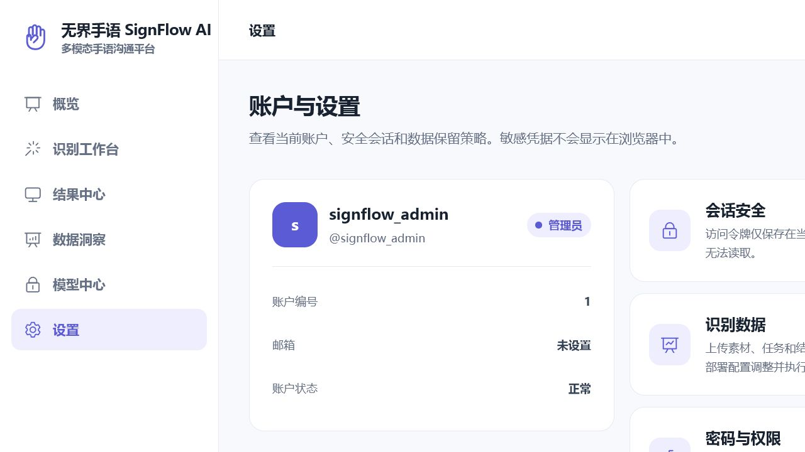

图 4-14　账户与设置：当前账户、安全会话、数据保留和权限说明

**入口与对象：** 当前登录用户查看账户、安全会话、数据保留和权限说明的统一页面。

**信息结构：** 页面展示账户编号、邮箱、状态和角色；会话安全卡说明访问令牌与 HttpOnly Cookie；识别数据卡说明默认 30 天保留；密码与权限卡说明 Django 安全哈希和前后端双重权限校验。

**核心操作：** 用户可以退出登录；管理员可以从团队与成员区域进入管理后台。敏感密码、完整服务密钥和数据库连接信息不会显示在浏览器中。

### 4.4 管理后台界面

<table>
  <tr>
    <td width="33%">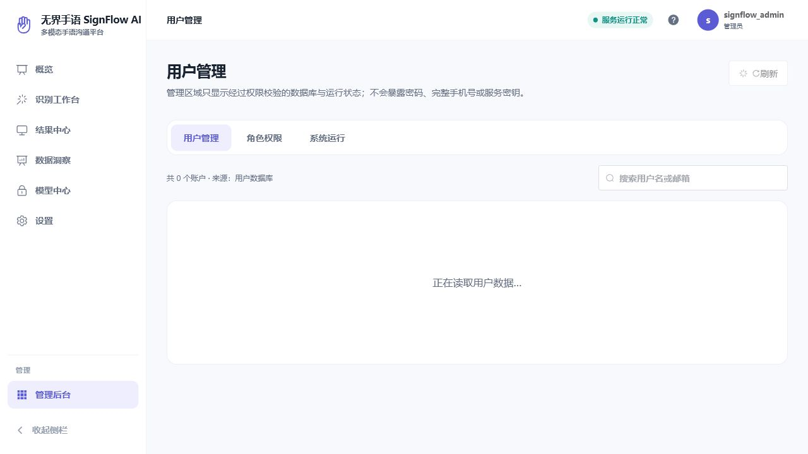</td>
    <td width="33%">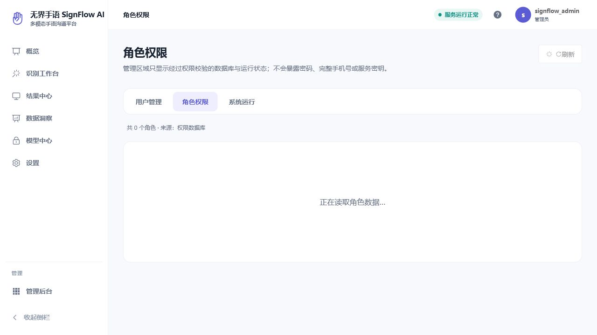</td>
    <td width="33%">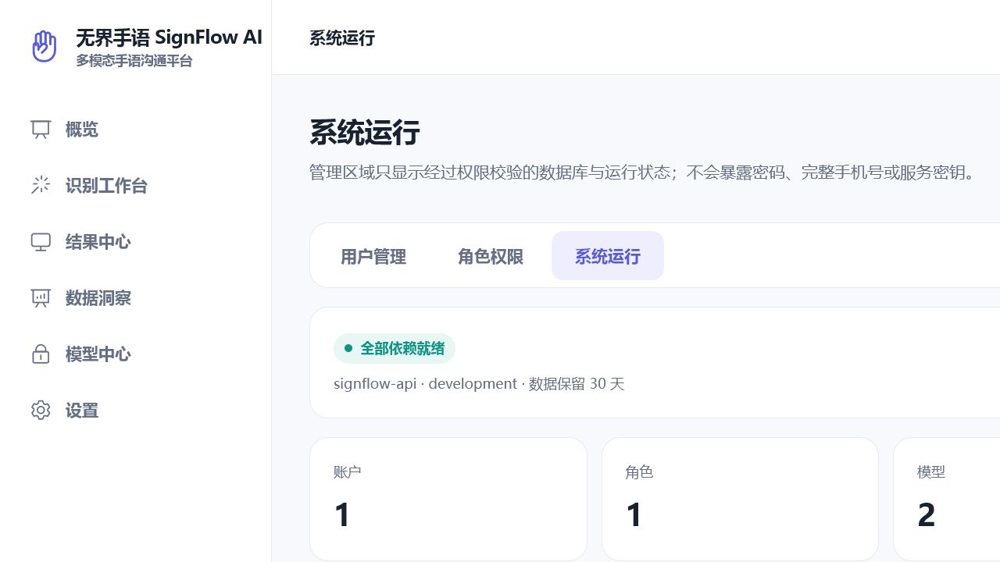</td>
  </tr>
  <tr>
    <td align="center">用户管理</td>
    <td align="center">角色权限</td>
    <td align="center">系统运行</td>
  </tr>
</table>

图 4-15　管理后台：账户、角色和依赖就绪状态统一受权限保护

#### 4.4.1 用户管理

**入口与权限：** 仅 `admin` 或 `superadmin` 角色可以访问；普通用户即使知道路由也会被前端守卫和后端接口共同拒绝。

**信息结构：** 页面提供用户总数、数据库来源说明、用户名或邮箱搜索、账户状态、角色和最近更新时间。管理界面只显示经过权限校验的业务字段。

**安全边界：** 页面不会暴露密码哈希、完整手机号、数据库密码、服务密钥或刷新令牌。用户状态修改与角色分配均由后端再次验证。

#### 4.4.2 角色权限

**入口与权限：** 超级管理员使用该页面检查角色定义和用户授权关系。

**信息结构：** 页面显示角色名称、代码、说明、成员数量和状态，当前本地产品环境包含超级管理员角色。

**权限模型：** 路由元数据用于前端导航控制，Django API 权限用于最终裁决。即使绕过前端隐藏菜单，未授权请求仍无法读取管理数据。

#### 4.4.3 系统运行

**入口与对象：** 面向本地产品管理员和部署运维人员，用于快速确认演示环境是否具备完整依赖。

**信息结构：** 页面显示 API 环境、数据保留期限、账户数、角色数、模型数以及依赖就绪状态，并明确管理区不会显示密码和完整服务密钥。

**运维价值：** 现场演示前可以通过该页面和 `/health/ready` 双重确认后端、数据库、模型记录及关键依赖是否可用。

### 4.5 手机端界面

手机端采用 uni-app，共用网页端后端账号、任务、模型和结果数据，可构建为 H5 与微信小程序。底部导航统一为“首页、识别、记录、我的”，八个普通/选中图标在构建后执行 PNG 签名、尺寸和字节一致性校验。

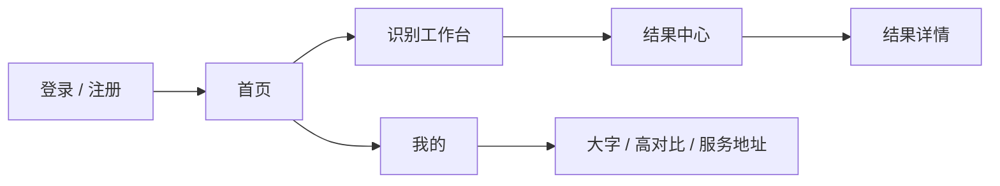

  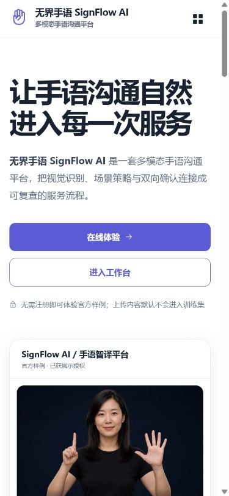

图 4-16　移动交付：响应式网页、H5 与微信小程序共享产品逻辑

#### 4.5.1 手机端登录

  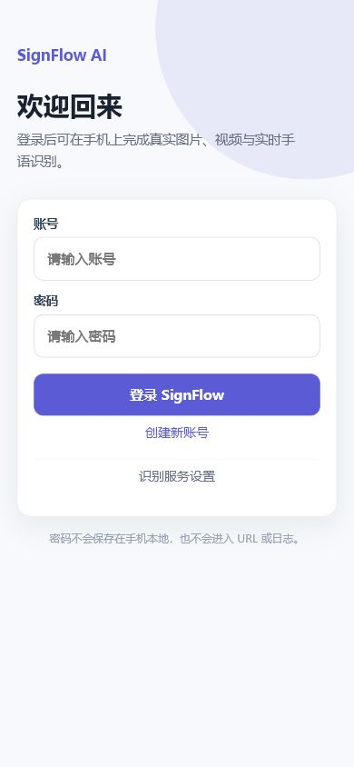

图 4-17　手机端登录：语义化表单、46px 触控按钮与服务设置

**页面目标：** 在有限屏幕上完成账号认证和服务地址配置，同时保持大触控区域和清晰表单语义。

**核心交互：** 账号和密码输入具有真实 label、placeholder、`aria-label` 和稳定 id；登录、创建账号、服务设置均为语义化按钮。服务设置支持本地调试环境填写电脑地址，正式小程序要求 HTTPS 白名单域名。

**安全设计：** 手机端不保存密码，不把密码写入 URL 或日志；登录失败显示可恢复提示。三个关键按钮实测高度 46px，高于 44px 触控基线。

#### 4.5.2 手机端注册

  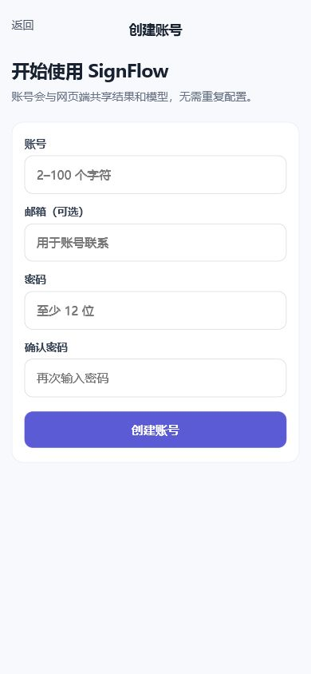

图 4-18　手机端注册：与网页端共享账户和后端验证规则

**页面目标：** 创建与网页端共享结果和模型的统一账号，不要求用户重复配置另一套身份。

**核心交互：** 账号、可选邮箱、密码和确认密码均有移动端输入提示；密码至少 12 位；顶部提供明确返回操作。

**一致性：** 注册请求复用同一后端验证规则，成功后返回登录流程，账户可立即在网页与手机端使用。

#### 4.5.3 手机端首页

**页面目标：** 让用户用最少步骤选择拍照、视频或实时输入，并快速看到服务状态与最近任务。

**信息结构：** 首页显示欢迎语、开始识别、识别服务运行状态、三种输入方式、今日真实任务、完成/处理中数量、成功率和最近结果。

**核心操作：** 用户可以直接进入对应输入模式、刷新服务状态、打开全部记录或从最近结果进入详情。

#### 4.5.4 手机端识别工作台

**页面目标：** 在拍摄现场完成图片、视频和实时手语识别，同时保留模型与输入设置。

**信息结构：** 顶部切换图片、视频和实时模式；中部选择或拍摄媒体；“输入与模型”区域显示当前 CSL/ASL 模型和版本；底部主按钮启动真实识别。

**终端差异：** H5 使用浏览器文件与媒体能力，微信小程序使用相机和媒体选择接口；真机摄像头和网络权限遵守系统授权，不在无权限时静默调用。

#### 4.5.5 手机端结果中心

  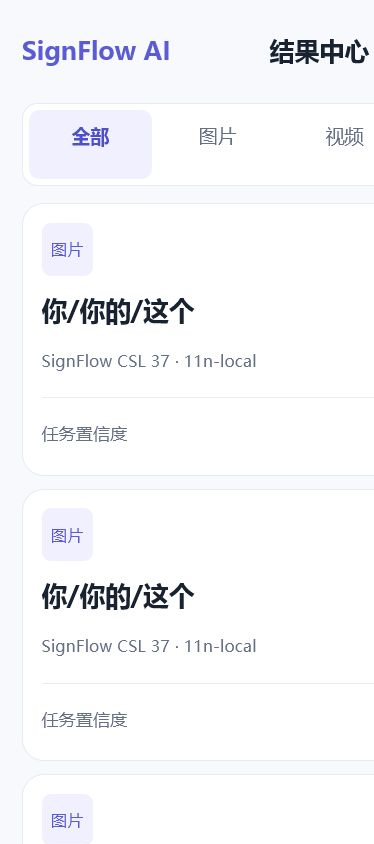

图 4-19　手机端结果中心：跨终端同步的识别任务卡片

**页面目标：** 以适合单手浏览的卡片形式查看跨终端同步的识别记录。

**信息结构：** 顶部按全部、图片、视频和实时筛选；任务卡展示输入类型、状态、识别文本、模型与版本、时间和任务置信度。

**核心操作：** 点击任务卡进入详情。列表读取与网页端相同的账户级任务 API，因此在网页产生的真实识别可以立即出现在手机端。

#### 4.5.6 手机端结果详情

**页面目标：** 在手机上完成结果复核和确认，而不只是查看一句识别文本。

**信息结构：** 页面展示真实/样例属性、识别文本、整体置信度、授权原始媒体、标签、输入类型、模型与版本、任务编号、创建时间、SHA-256、识别参数和版本列表。

**核心操作：** 用户可以复制、确认、重新识别和保存结果。已清理的历史媒体会显示不可读取说明，仍保留任务与版本元数据。

#### 4.5.7 手机端“我的”

**页面目标：** 集中管理当前账号、识别服务地址、无障碍显示和隐私说明。

**核心操作：** 用户可以保存服务地址、切换大字模式和高对比模式、查看“不进入训练集、默认保留 30 天、密码不在手机保存”等策略，并安全退出登录。

**可访问性：** 状态按钮同时呈现功能名称、说明和开关状态，触控区域不依赖小图标；设置在本地持久化后应用于其他手机页面。

### 4.6 跨界面一致性

- 公共页、登录页、应用页和管理页使用统一品牌、颜色、字体层级和真实路由，但根据信息密度采用不同布局。
- Web 与手机端共享账户、模型、任务、结果和确认状态；端侧只负责适配输入能力和交互密度，不复制一套假数据。
- 所有关键页面都有加载、空数据、失败、无权限和页面不存在状态，避免演示时出现空白屏。
- 场景建议、模型指标、演示样例和真实任务使用不同标记，降低用户把样例或单次置信度误解为总体准确率的风险。
- 响应式 Web 在 390×844 视口下无横向溢出；H5 与微信小程序共用页面逻辑，并对底栏图标和触控尺寸执行自动化回归。

<a href="#top">返回顶部 ↑</a>

---

## 5. 技术架构

系统采用前后端分离与统一推理服务架构。网页端使用 Vue 3、Vue Router 和 Element Plus；手机端使用 uni-app，同时构建 H5 与微信小程序；后端使用 Django REST Framework、Channels 和 WebSocket；推理层通过 Ultralytics YOLO 加载现有 CSL/ASL 权重并进行模型缓存；数据层支持关系数据库、Redis 和 S3 兼容对象存储。

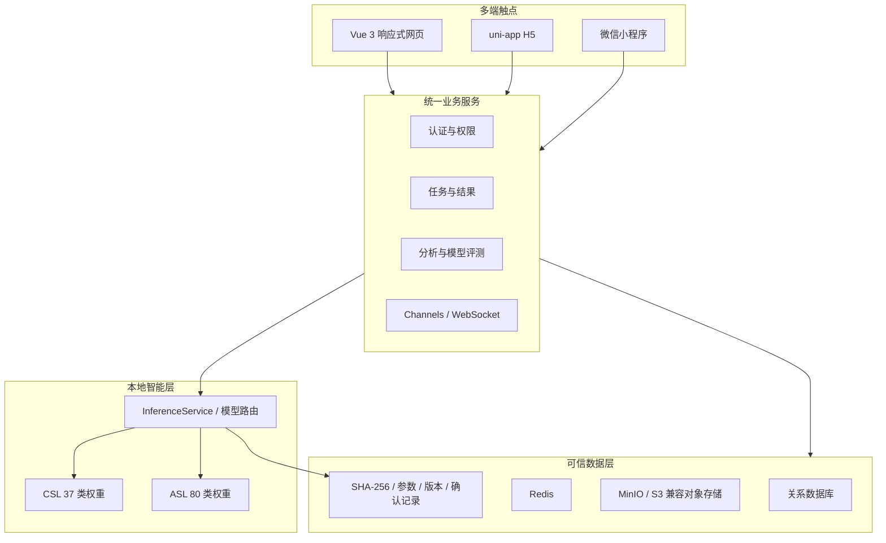

### 关键工程设计

| 模块 | 设计要点 | 产生的价值 |
|---|---|---|
| 模型路由 | 任务显式保存语言类型、模型标识和参数 | 避免模型混用，结果可复现 |
| 推理服务 | 权重缓存、图片与视频统一返回结构 | 降低重复加载成本 |
| WebSocket | 摄像头会话、票据与连接状态管理 | 支持实时识别与故障恢复 |
| 结果中心 | 原始媒体、哈希、版本与确认状态持久化 | 满足复核、审计和重新识别 |
| 产品数据层 | 概览、分析、模型评测统一读取真实后端数据 | 避免前端硬编码指标 |

<a href="#top">返回顶部 ↑</a>

---

## 6. 本地模型与真实评测

当前系统使用两套现有本地多类别手语识别模型。本次只运行推理和评测，没有重新训练。检测指标由现有权重调用 `YOLO.val` 获得，产品链路指标由图片和视频回归素材重复推理获得。

图 6-1　模型评测卡：Precision、Recall、mAP、延迟、硬件与能力边界

### 检测指标

| 模型 | 语言 / 类别 | 评测数据集 | 样本 / 实例 | Precision | Recall | mAP50 | mAP50-95 |
|---|---|---|---:|---:|---:|---:|---:|
| `csl.pt` | CSL / 37 类 | CSL-37 带框独立测试集 | 347 / 346 | 99.63% | 99.20% | 99.49% | 84.29% |
| `ASl-v8.pt` | ASL / 80 类 | ASL-80 带框保留验证集 | 2,053 / 2,085 | 97.63% | 98.81% | 98.94% | 76.94% |

### 产品链路性能

| 模型 | 回归素材 | 标签 Precision / Recall | 单张平均延迟 | 视频处理速度 |
|---|---:|---:|---:|---:|
| CSL-37 | 5 个：2 图、3 视频 | 100% / 100% | 76.83 ms | 11.48 FPS |
| ASL-80 | 10 个：5 图、4 视频、1 负样例 | 100% / 100% | 83.15 ms | 11.75 FPS |

评测硬件为 Intel Core i7-13700H CPU，输入尺寸 640×640，产品链路阈值为置信度 0.45、IoU 0.50，评测日期为 2026-07-30。

### 指标解释与能力边界

- CSL 使用仓库数据配置中明确声明的 `test` split，但现有文件仍不足以证明不同 split 的采集主体完全独立。
- ASL 数据只提供 `train` 与 `val`，因此 ASL 指标必须表述为训练期间可见的验证集结果，不是外部独立盲测。
- 小规模产品回归集用于证明图片、视频、标签映射和负样例链路真实可用，100% 回归通过率不能替代总体准确率。
- 当前能力属于固定词汇的目标检测式识别，不等同于开放词汇或连续手语自然语言翻译。
- 光照、遮挡、多人、手部出框、动作速度与拍摄角度会影响结果；关键内容应由沟通双方确认。

<a href="#top">返回顶部 ↑</a>

---

## 7. 真实识别与场景沟通

图 7-1　真实推理：上传 CSL 图片后完成识别、场景建议与双方确认

2026-07-30 浏览器验收使用项目内 CSL 测试图片 `you.jpg` 进行真实上传。工作台成功接收文件并调用本地模型，返回“你/你的/这个”，整体置信度 92.6%，任务耗时 7.12 秒，模型版本为 `SignFlow CSL 37 11n-local`。结果页同时展示边界框、分词标签、场景建议、朗读、复制、协助卡和双方确认入口。

本次验收还验证了 CSL 与 ASL 类型切换。选择英文手语后，ASL 按钮的 `aria-pressed` 状态变为 `true`；切回中文手语后 CSL 状态恢复。图片上传入口支持 PNG、JPG 和 WebP，视频入口支持真实媒体任务，摄像头入口使用授权后连接的实时服务。

> 单次任务的 92.6% 是该输入的模型置信度，只用于证明完整推理链路，不作为总体模型准确率。

### 三种场景策略

| 场景 | 输出策略 | 风险控制 |
|---|---|---|
| 政务服务 | 提示复述事项、材料与无障碍人工协助需求 | 双方确认后再继续办理 |
| 医疗导诊 | 提示确认症状表达、科室和人工导诊需求 | 明确不替代诊断与医嘱 |
| 特殊教育 | 提示复述学习内容、节奏与反馈需求 | 教师确认后进入教学环节 |

<a href="#top">返回顶部 ↑</a>

---

## 8. 结果追溯、隐私与安全

图 8-1　可信结果：原始媒体、SHA-256、模型版本、识别参数与确认记录

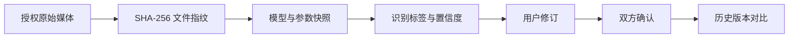

结果详情不是一张静态结果卡，而是一条可复核的证据链。经过授权的原始图片或视频与识别结果共同保存；系统记录 SHA-256 文件哈希、模型版本、置信度与 IoU 参数、识别时间、任务来源、确认状态和结果修订版本。用户可以重新识别并比较不同版本，已有记录支持持久化的“双方已确认”状态。

### 数据治理

- 上传内容仅用于生成当前识别结果，不会默认进入训练集。
- 数据保留策略在独立隐私页面公开，默认保留期限可由部署方配置。
- 结果中心支持导出与删除流程，访问受认证、权限和对象级校验约束。
- 历史记录中可恢复的文件使用真实 SHA-256；原文件缺失时不伪造哈希，并明确标注资产不可用。

### 生产安全

项目已建立不提交 Git 的 `.env`，使用高强度 `DJANGO_SECRET_KEY`，并配置数据库、Redis 和 MinIO 密码。Django 调试模式、CORS、CSRF、代理 HTTPS 与安全 Cookie 按生产策略配置。`docker compose config` 和 Django 部署检查已通过；HSTS 子域和 preload 暂时保持关闭，待真实 HTTPS 域名及所有子域验证完成后再启用，避免错误锁定本地或未迁移域名。

网页端与手机端生产依赖审计均为 **0 个已知漏洞**。ECharts 和 DCloud/uni-app 依赖链已升级并重新构建。

<a href="#top">返回顶部 ↑</a>

---

## 9. 多端交付与无障碍设计

  

图 9-1　响应式网页：390×844 视口无横向溢出和破图

网页端在 390×844 视口下没有横向溢出、空链接或破图，公共首页和识别工作台可在手机浏览器中直接使用。uni-app 手机端提供 H5 和微信小程序两套构建产物，文案统一使用“本地调试环境”，不暴露比赛或开发残留。

### 可访问性验收

| 检查项 | 实测结果 |
|---|---|
| 输入框 | 账号和密码均有程序化 label、placeholder、`aria-label` 和稳定 id |
| 语义按钮 | 登录、注册和设置均为可聚焦 button，`tabIndex=0` |
| 触控尺寸 | 三个关键按钮实测高度均为 46px，高于 44px 基线 |
| 键盘操作 | 登录按钮按 Enter 可触发校验并显示“请输入账号和密码” |
| 视觉辅助 | 大字、高对比状态可持久化，并有清晰焦点样式 |
| 图片资源 | 8 个底栏图标均为 200×200 二进制 PNG；H5 与微信产物同步校验通过 |
| 响应式 | 390×844 下无横向溢出，手机端无无效图片 |

本轮完整验收发现，底栏图标源文件虽正确，但最初的生产构建没有复制到 H5/微信产物。现已新增构建后同步与逐文件 PNG 签名、尺寸、字节一致性校验，并重新构建复测，浏览器无效图片数量由 4 降为 0。

<a href="#top">返回顶部 ↑</a>

---

## 10. 完整工程验收

图 10-1　工程验收完成态：任务统计、趋势和依赖服务均可核验

### 自动化测试与构建

| 子系统 | 验收命令 / 范围 | 结果 |
|---|---|---|
| 网页端单元测试 | 19 个测试文件 | 42 / 42 通过 |
| 网页端质量 | ESLint、Vite production build | 通过，2,363 个模块完成构建 |
| 网页端依赖安全 | `pnpm audit --prod` | 0 个已知漏洞 |
| 手机端单元测试 | 无障碍、API、任务状态、图标资产 | 11 / 11 通过 |
| 手机端构建 | H5、微信小程序 | 两套构建均通过 |
| 手机端依赖安全 | `pnpm audit --prod` | 0 个已知漏洞 |
| 后端测试 | pytest 全量 | 70 / 70 通过 |
| Python 质量 | Ruff lint、format、`pip check` | 全部通过 |
| 数据库一致性 | `makemigrations --check` | 无待生成迁移 |
| 容器配置 | `docker compose config --quiet` | 通过 |
| Django 生产检查 | `check --deploy` | 通过；仅保留 2 项待真实域名启用的 HSTS 提示 |

### 浏览器端到端验收

| 页面 / 流程 | 验证内容 | 结果 |
|---|---|---|
| 首页与产品导览 | 商业化视觉、真实路由、产品能力链接 | 通过 |
| 隐私与数据保留 | 9 个政策章节、真实页脚路由 | 通过 |
| 登录与概览 | 管理员认证、后端在线状态、真实统计 | 通过 |
| 识别工作台 | 上传 `you.jpg`、CSL 推理、结果动作 | 通过 |
| 模型中心 | CSL/ASL 评测卡、硬件、日期与边界 | 通过 |
| 结果中心 | 36 条任务、原始媒体、哈希与版本 | 通过 |
| 数据洞察 | 3 张 ECharts 图表、响应式和导出入口 | 通过 |
| 手机端 H5 | 表单语义、键盘、触控、图标、溢出 | 通过 |
| 控制台 | 关键页面 error / warning | 0 条 |

当前数据洞察的七日成功率为 28.1%，该口径包含开发与验收阶段刻意制造的失败路径记录；当日概览显示 6 条任务、成功率 100%。报告保留这一差异，不把测试数据包装为线上业务表现。

<a href="#top">返回顶部 ↑</a>

---

## 11. 创新性、应用价值与演进路线

项目的创新重点不在于重新发明一个分类网络，而在于把现有视觉模型变成可信、可使用、可交付的无障碍产品：

- **从标签到行动：** 识别后直接进入场景沟通建议、朗读、复制、协助卡和双方确认。
- **双语模型产品化：** CSL 与 ASL 在同一工作台显式切换，模型卡说明数据、指标、硬件和边界。
- **结果证据链：** 原始媒体、SHA-256、参数、模型版本、确认状态和修订历史可被共同复核。
- **多端一致交付：** 网页、H5、微信小程序复用同一产品逻辑，并对可访问性和触控尺寸自动回归。
- **诚实评测：** 独立测试集、训练可见验证集、产品回归集和单次置信度采用不同口径，不混为总体准确率。

### 应用与推广

平台可用于政务大厅的常见事项沟通、医院预检分诊的表达辅助、特殊教育中的固定词汇练习，也可扩展到银行、电信、交通枢纽和社区服务。机构侧可以采用本地化部署，保留模型、数据和审计记录的控制权；产品侧可按服务点、并发规模、模型包和运维支持形成商业方案。

### 下一阶段路线

1. 建立跨主体、跨设备、跨光照的外部独立盲测集，补充不同人群的公平性评估。
2. 从固定词汇检测扩展到连续手语时序识别和自然语言重排，但继续保留人工确认。
3. 在 GPU、边缘计算盒和主流手机上完成分层性能测试与模型压缩。
4. 接入真实 HTTPS 域名后启用 HSTS includeSubDomains 与 preload，并进行第三方渗透测试。
5. 在真实服务点开展小规模试点，记录任务完成率、人工接管率、沟通耗时和用户满意度。

<a href="#top">返回顶部 ↑</a>

---

## 12. 现场演示与提交说明

### 90 秒演示建议

| 时间 | 演示动作 | 讲解重点 |
|---|---|---|
| 0—15 秒 | 打开产品首页 | 一句话说明“让手语沟通自然进入每一次服务” |
| 15—30 秒 | 进入产品导览 | 展示多模态、双模型、三场景和可信闭环 |
| 30—55 秒 | 上传 CSL 测试图片 | 真实推理并展示标签、置信度、耗时和模型版本 |
| 55—72 秒 | 展示沟通动作 | 朗读、复制、协助卡与双方确认 |
| 72—84 秒 | 打开结果详情 | 原始媒体、SHA-256、参数和版本对比 |
| 84—90 秒 | 打开模型中心 | 指出真实评测指标与能力边界 |

### 本地运行入口

| 入口 | 地址 |
|---|---|
| 产品首页 | `http://127.0.0.1:8080/` |
| 产品导览 | `http://127.0.0.1:8080/product-tour` |
| 识别工作台 | `http://127.0.0.1:8080/app/workbench` |
| 模型中心 | `http://127.0.0.1:8080/app/models` |
| 结果中心 | `http://127.0.0.1:8080/app/results` |
| 后端健康检查 | `http://127.0.0.1:8001/health/ready` |

### 提交边界声明

- 本次没有训练或修改权重；所有指标来自现有权重的真实评测。
- CSL 与 ASL 当前只覆盖固定类别，不能表述为开放词汇连续手语翻译。
- 医疗场景只提供沟通辅助，不替代诊断、医嘱或专业手语翻译。
- 本地演示地址只用于现场运行；正式上线需要配置真实域名、证书和部署环境。

---

<h3>让手语被看见，让公共服务真正抵达每一个人。</h3>

<strong>无界手语 SignFlow AI</strong>

<a href="#top">返回顶部 ↑</a>

